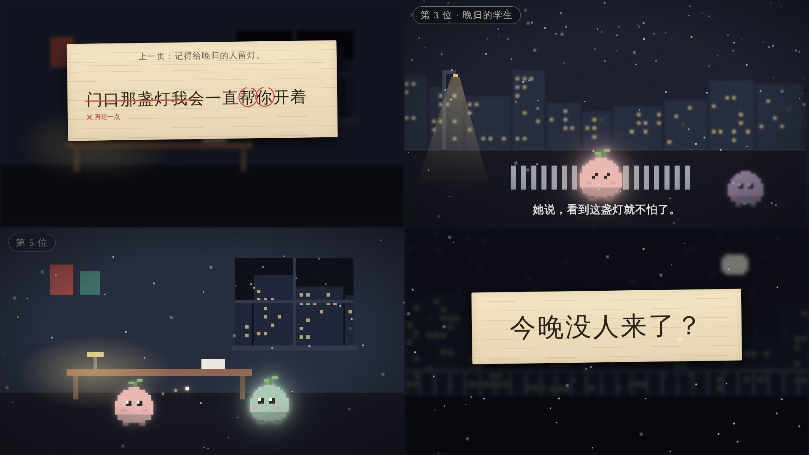

# 夜色像素风

深夜城市里的一串小故事：藏青夜色的像素小场景、一处暖光、会发光的方块小角色，故事的关键句写在一张米黄横线信笺上，钢笔逐字写出、红笔批改、盖章通过。适合「接力 / 交接 / 传话」「一晚上的 N 个人」这类串联式、温情向的无口播或轻口播短片。画面语法是从参考视频（`template/人生容错率.mp4`，960×544、30fps、134 秒，不进 git）里拆出来的，组件和示例都是重写的，没有沿用原片的内容、文案、角色和水印。

拆解包：`materials/00-公共/风格蒸馏/night-pixel/人生容错率/report.md`（镜头表、色板、运动强度、卡点），动效切片在同目录 `strips/`，局部放大在 `crops/`。

## 画面特征

### 镜头节奏和硬切频率

- 134 秒 51 个硬切、52 个镜头：平均 2.6 秒，中位 2.1 秒；10% 分位 0.63 秒、90% 分位 4.8 秒。
- **两种节奏交替**：
  - 「信笺段」是长镜头（3.6～6.9 秒），镜头内只有写字、批改这些细动作，运动强度几乎为 0（0.004）。
  - 「接力段」是加速硬切：27–37 秒连切 9 刀，镜头长 1.2 → 1.2 → 0.9 → 0.6 → 0.6 秒，73–75.4 秒又是一串 0.6 秒。每 10 秒最多 8 刀，出现在 30–40 秒和 70–80 秒两段。
- 切点约一半落在 0.3 秒（9 帧）的整数倍上，加速段用的就是 36 / 27 / 18 帧这几档。
- **硬切不卡配乐**：切点对 0.614 秒拍子网格的贴合度和随机差不多（0.1 秒内 27%，随机 32%），切点跟着文案和故事走，不跟音乐走。
- 镜头里一直在轻微地动：接力段每个镜头横移约 2–3%，长镜头带缓慢推近。

### 画面布局（以 1920×1080 计）

- **固定版式**：
  - 左上角章节胶囊「第 N 位 · 角色」：x=40、y=30，高约 70。
  - 底部居中字幕：基线约 y=960，没有底条。
  - 原片右下角是平台水印，没有复制。
- **信笺卡**：
  - 宽约 2/3 画面（1280×460），水平居中、微旋 -0.8°，偏上放（y≈200），下方留出字幕位。
  - 卡片出现时，背后的像素场景退成景深：模糊 10px、压暗 45%。
- **像素场景**：
  - 地平线在画面 65%–80% 高度，角色站在地面上，高约画面 1/5（约 200px）。
  - 远景楼群虚化，焦点永远在角色。
- **聊天窗**：居中的深色窗口约 56% 宽，用于开头和结尾的首尾呼应。

### 配色和强调色

- 底色按面积依次是藏青夜 `#171a28`（21%）、`#212738`（16%）、`#10111b`（13%）、`#070a11`（7%）。整片平均亮度 0.26，暗部（<0.12）占 38%。
- 暖光是唯一光源：窗格和台灯 `#e4c988`，木色 `#8e604d` / `#634b3c`。强调色里暖色占 75%，冷蓝 `#3f5065` / `#6286ab` 只做玻璃和远处灯。
- 信笺米黄 `#eedebc`（边缘 `#d8c9a8`），正文深墨褐 `#2a2118`，抬头 `#6b6150`。
- 批改红 `#c9473a`、通过绿 `#4f9a5a` **只在信笺上出现**，一张卡最多一处红圈组 + 一枚绿章。
- 角色是低饱和粉彩（米白、粉、薄荷、淡紫、鹅黄），自带一圈同色柔光（bloom）。暗场里最亮的就是角色和光点。

### 字体层级

| 层级 | 用途 | 字体 | 字号（1080 高） |
|---|---|---|---|
| 1 | 信笺正文（关键句） | 宋体，像钢笔字 | 100–124px，字距 0.06em |
| 2 | 字幕 | 粗黑体 700，白 `#e2e3e6`，柔黑影 | 52px |
| 3 | 章节胶囊 | 宋体，米色 `#d8ccb1`，字距 4 | 44px |
| 4 | 信笺抬头「上一页：……」 | 宋体，灰褐 | 40px，下面一条细分隔线 |
| 5 | 红笔批注、绿章 | 宋体 | 30–38px |

数字和西文跟随中文字体，等宽代码用系统等宽。

### 入场和转场

- **写字**：逐字写出，每字 4–5 帧（原片「我喜欢你」4 字约 20 帧），钢笔尖停在当前字右上方。
- **红笔批改**：
  - 红圈一笔画出约 8 帧，多个字依次间隔 6 帧。
  - 接着红线从左到右划掉整行（8 帧），再淡入批注（6 帧）。
  - 整稿 6 帧淡出后重写。
- **通过章**：从 1.6 倍砸到 1 倍（6 帧，easeOutBack），倾斜 -8°。
- **信笺 ↔ 场景**：糊化交叉约 10 帧，透明度和模糊同时收放，不硬切。原片 11.24→11.53 秒、18.57→18.91 秒都是 9–10 帧。
- **场景 ↔ 场景**：
  - 故事段用 10 帧糊化交叉，原片 42.4 秒处带景深溶解。
  - 接力段用硬切。
- **字幕、章节胶囊**：镜头稳定后 4–6 帧淡入，跟随镜头切换。
- **接力光点**：从 A 飞向 B，用镜头长度的约 55%，先快后慢，带 8 段拖尾，到达后在 B 处闪一圈。

### 配乐卡点

- 原片整片约 −15 LUFS。音乐是稳定律动，约 99 BPM（一拍 0.6 秒），全片能量起伏很小。
- 画面**只在一处**卡音乐：
  - 第 22 小节的最大重拍（54.07 秒），能量先回落、再冲高 13 dB。
  - 这一拍落在招牌镜头「一片雪落在句号上、句号变成问号」上：雪片从 52.7 秒开始飘，54 秒左右落到字上。
- 其余画面节点跟文案走。
- 套用到本仓库：
  - 配乐一律走音乐库，用 `beats.py` 测出最大的「换气 + 重拍」，只把招牌动作放在那一帧，其余照文案排。
  - `NoteCard` 的 `swap.at` 就填那一帧。

### 招牌画面

1. 米黄信笺上钢笔逐字写一句话 → 红笔圈出问题字、划掉、红字批注 → 重写 → 右下绿章通过。
2. 接力光点在发光小角色之间传递，镜头越切越快（36 → 27 → 18 → 12 帧）。
3. 雪片飘落到句末标点上，在配乐最大重拍那一帧把「。」改成「？」。

## 组件

| 文件 | 组件 |
|---|---|
| `src/library/night-pixel/theme.ts` | 配色 `NP`、字体 `NPF`、像素单位 `PX`；`dissolve` 糊化交叉、`fade` 淡入、`written` 写字进度、`bloom` 发光、`hexA`、`cutAt` 加速硬切表 |
| `src/library/night-pixel/stage.tsx` | `PixelCanvas` 240×135 像素格画布、`NightScene`（`street` / `room` / `rooftop` / `kitchen`，`pan` 横移）、`Snow`、`Vignette` 暗角颗粒、`Depth` 景深层、`Drift` 横移推近、`Blend` 糊化交叉容器、`ChapterPill` 章节胶囊、`NPCaption` 字幕 |
| `src/library/night-pixel/props.tsx` | `PixelPal` 发光像素小豆子（表情、朝向、眨眼、上下浮动）、`LightOrb` 接力光点、`NoteCard` 横线信笺（`drafts` 多稿、`marks` 红圈、`strikeAt` 划掉、`note` 批注、`stamp` 通过章、`swap` 雪落改标点）、`PassStamp`、`ChatWindow` 深色聊天窗（气泡、正在输入）、`Passerby` 虚化路人 |

## 关键代码

- 素材库：`src/library/night-pixel/`（目录见 `src/library/README.md`「夜色像素风」一节）
- 预览：Studio 里的 `library-night-pixel`（`src/library/previews/NightPixelDemo.tsx`，1920×1080，8 场 × 150 帧）
- 测试：`tests/library/night-pixel.test.ts`

## 没有搬的东西

- 原片的题材和文案都没有带进来：AI 传话实验、「我爱你 / 今晚月色真美」、「不能用上一句里的字」这条规则，以及每一棒的人物设定、字幕原文都没有沿用。预览改成「便利店夜班的交接本」，批改规则改成「再短一点」。
- 角色：原片是方块豆腐形小人，这里重画成圆角豆形 + 头顶小芽 + 带高光的大眼，轮廓和比例都不同。
- 平台水印、创作者账号、结尾的平台关注页一律没有做。
- 原片配乐不进素材包，用的时候走 `public/music/` 音乐库并重测拍子。
- 原片的帧只用于拆解，放在 `materials/`（不进 git）；`预览.jpg` 全部是本组件渲染的画面。

## 还没做到的

- 信笺字体：容器里没有中文衬线字体，Linux 上会回落成黑体；在 macOS 上是宋体，效果接近原片。需要跨平台一致时，加一款 OFL 衬线中文字体（例如思源宋体）进 `public/fonts/` 并更新 `LICENSES.md`。
- 像素场景只有 4 种底景；原片还有地铁、医院、车站、厨房瓷砖墙等十几种，需要时照 `NightScene` 的格坐标写法加。

## 期数

还没有正式使用的期数。
